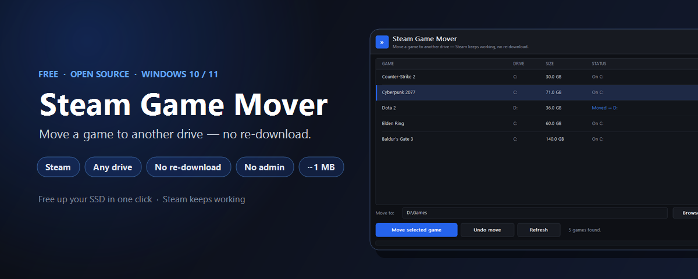
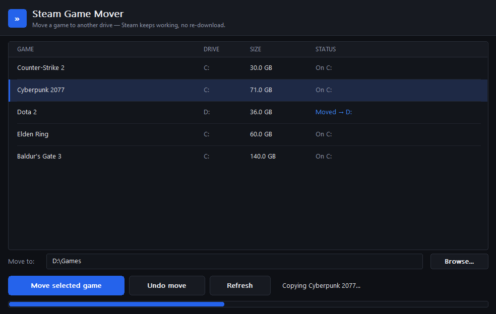
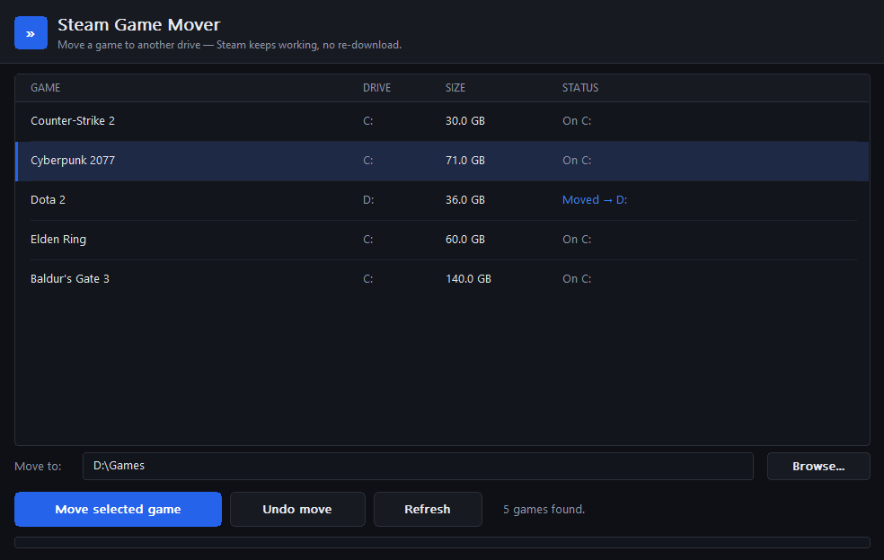

  

<h1 align="center">Steam Game Mover</h1>

  <b>Move a Steam game to another drive in one click — Steam keeps working, no re-download.</b> 
  A tiny, free, offline tool for Windows 10 / 11 (64-bit).

  
  
  
  
  

---

## What it does

Your SSD fills up and the biggest culprit is games. Moving a Steam game to another drive normally means **uninstall → re-download tens of gigabytes**. 

**Steam Game Mover** does it the smart way: it **physically moves** the game's folder to the drive you choose and leaves a tiny **link (junction)** behind in the old spot. Steam still finds the game exactly where it expects it and launches it from the new drive — **nothing to re-download, no Steam settings to touch.**

  

## Features

- 🎮 **One-click move** — pick a game, pick a drive, done
- 💾 **Free up your SSD** — send big games to an HDD or second SSD
- ⚡ **No re-download** — the files are moved, not re-fetched
- 🔗 **Steam keeps working** — a junction keeps the game visible in its library
- ↩️ **Undo** — bring a game back to its original drive anytime
- 🛡️ **Safe by design** — it **verifies the copy** matches before removing the original, and **rolls back** on any error (never leaves you with half a game)
- 🔓 **No admin required** — runs as a normal app
- 🪄 **Self-setup** — adds a Desktop and Start-Menu shortcut on first run
- 🪶 **Tiny** — a single **~1 MB** native binary, nothing to install
- 🔒 **100% offline & private** — no account, nothing uploaded
- 🆓 **Free and open source** (MIT)

## How to use

1. Download the latest release and unzip it.
2. Launch **Steam Game Mover** from the unzipped folder.
3. Pick a game from the list.
4. Click **Browse…** and choose the destination drive / folder.
5. Click **Move selected game**. When it finishes, launch the game from Steam as usual.

> To bring a game back, select it and click **Undo move**.

  

## How it works

Steam loads a game from `…\steamapps\common\<Game>`. Steam Game Mover copies that folder to your chosen drive, checks that every file arrived intact, removes the original, and creates an **NTFS directory junction** in its place pointing to the new location. To Steam (and Windows) the game is still right where it was — it just lives on another drive now. Junctions need **no administrator rights**.

## Safety

- The original is **only deleted after** the copy is verified (file count **and** total size).
- If anything goes wrong at any step, it **rolls back** — your game is never left broken or duplicated.
- Moving does not modify Steam's configuration; **Undo** fully reverses it.

## Download

➡️ **[Download the latest release](../../releases/latest)** — unzip and launch **Steam Game Mover**. Windows 10 / 11, 64-bit.

## Built with

Plain Win32 / C++ and the Windows API — **no third-party components**, no bundled binaries. The whole app is one small native executable. Released under the **MIT License** — see [LICENSE](LICENSE). Building from source is described in [BUILD.md](BUILD.md).

---

<b>Keywords:</b> steam game mover · move steam games to another drive · move steam games to ssd · move steam games to hdd · change steam install location · steam library mover · free up ssd space · move game folder · junction · free · no ads · no account.
